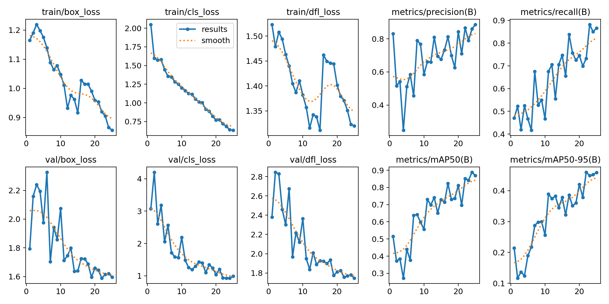
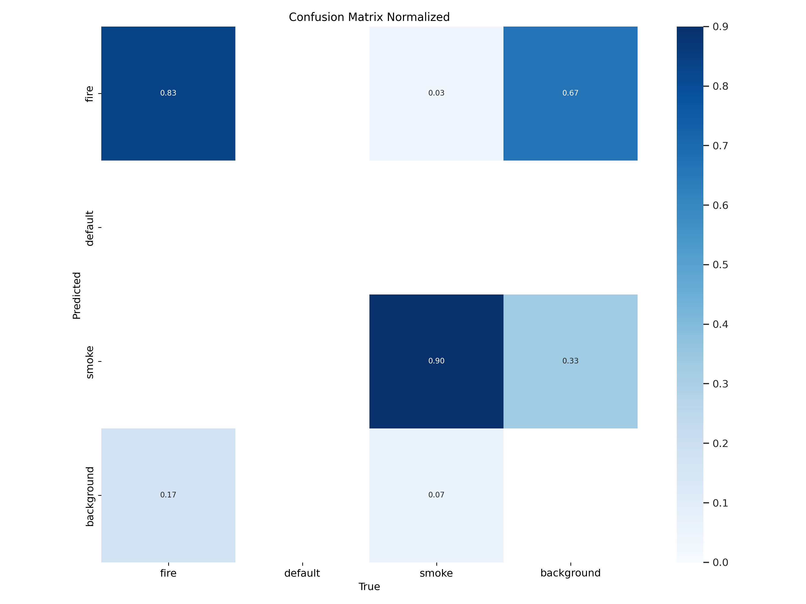
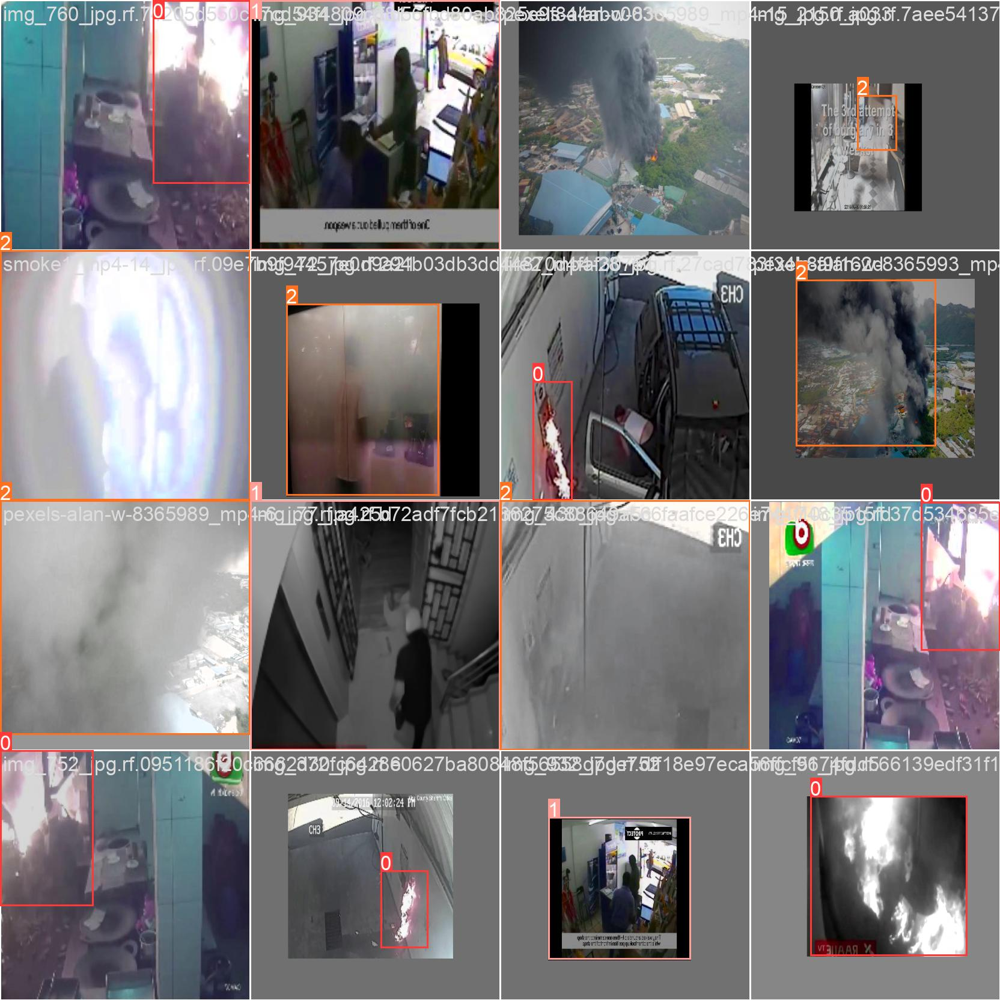
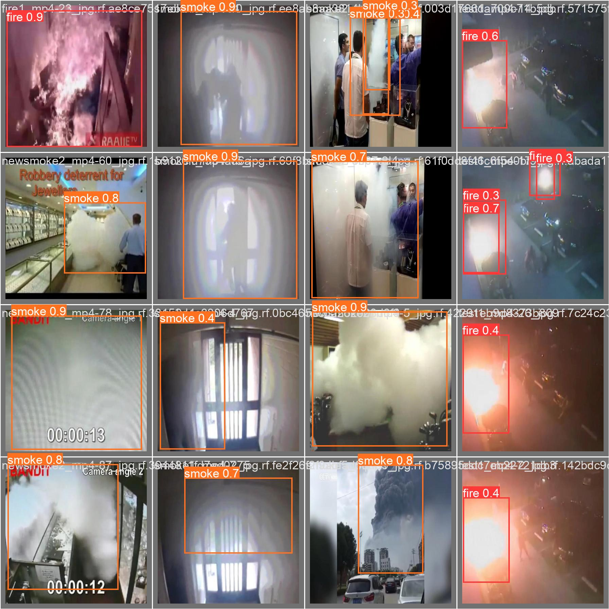
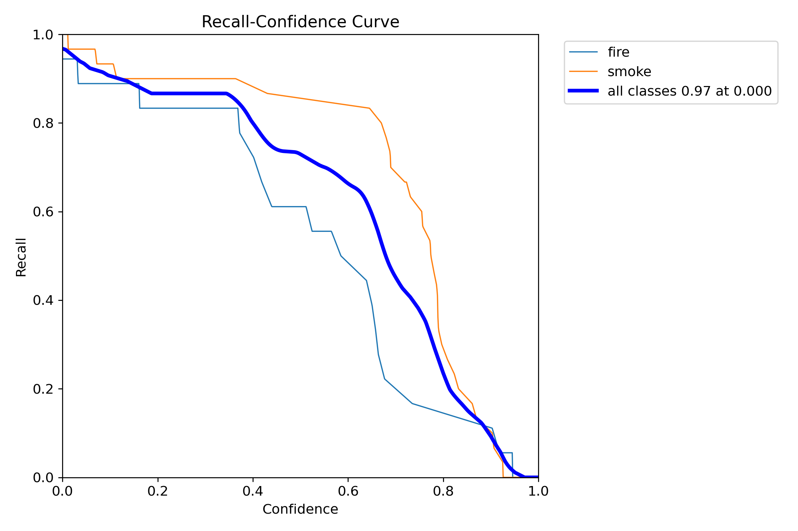
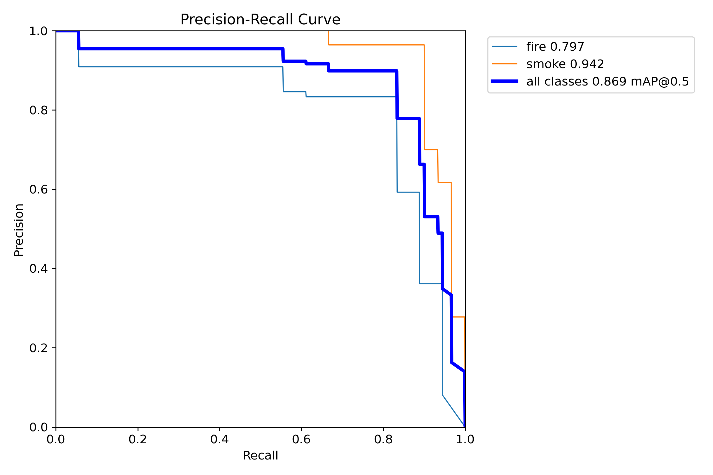
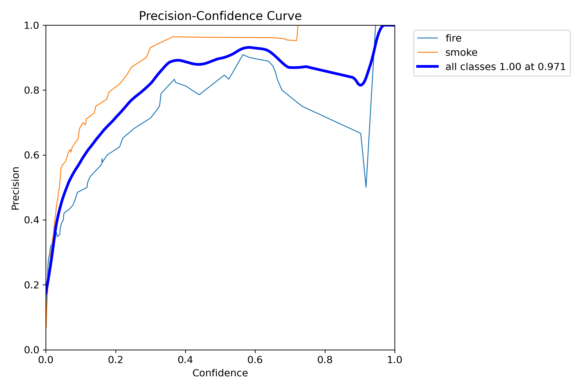
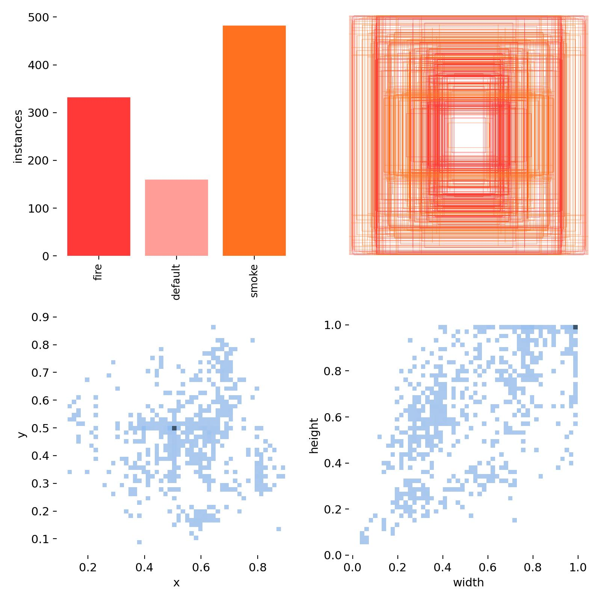
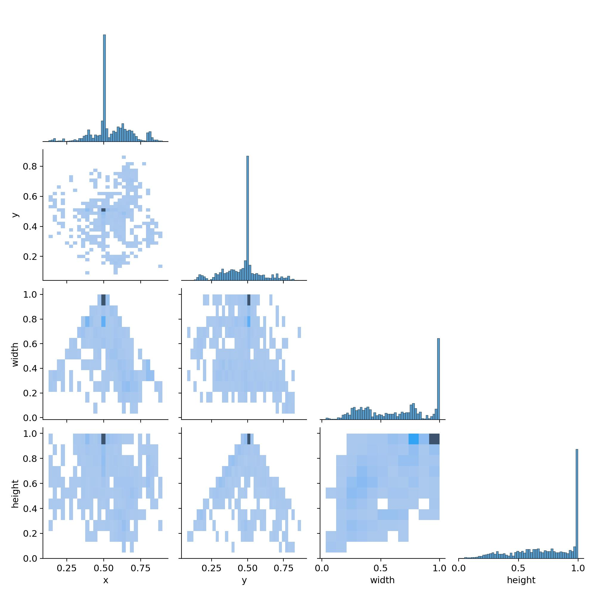

# FireGuard Machine Learning AI

FireGuardML uses [Ultralytics YOLO26s](https://docs.ultralytics.com/models/yolo26/) to train a fire and smoke detector on images.


For this project you have two options:
* Use pre-trained model in release, check **Model**
* Train model by yourself, check **Train**

## Table of Contents
1. [Model](#model)
2. [Train](#train)


--------------------------

## Model

If you want to use the model directly without training your own model, download the `FireGuardBestModel.pt` or `FireGuardLastModel.pt` from [release](https://github.com/ZhengLinLei/FireGuardML/releases/)

### Usage

Run this example from `src/` with JPEG images in `img/` at the repository root. Update the checkpoint path if training printed a different run directory.

```python
import cv2
from ultralytics import YOLO
import math
import os

# Cargar el modelo
model = YOLO('./FireGuardBestModel.pt')

# Leer las clases
classnames = ['fire', 'neutral', 'smoke']

# Crear un directorio para guardar las imágenes procesadas
os.makedirs('../tmp', exist_ok=True)

# Lista de imágenes a procesar
# Coger las imagenes de ./img sin . .. y otros que no sean .jpg
images = [img for img in os.listdir('../img') if img.endswith('.jpg')]

for image_path in images:
    # Leer la imagen
    frame = cv2.imread(f'../img/{image_path}')
    frame = cv2.resize(frame, (640, 480))

    # Procesar la imagen con YOLO
    result = model(frame, stream=True)
    # Get confidence and class names
    # print(result[0])

    # Obtener la información de bbox, confianza y nombres de clases para trabajar con ella
    for info in result:
        boxes = info.boxes
        for box in boxes:
            confidence = box.conf[0]
            confidence = math.ceil(confidence * 100)
            Class = int(box.cls[0])
            if confidence > 10:
                x1, y1, x2, y2 = box.xyxy[0]
                x1, y1, x2, y2 = int(x1), int(y1), int(x2), int(y2)
                print(f'Class: {classnames[Class]}, Confidence: {confidence}%')
                cv2.rectangle(frame, (x1, y1), (x2, y2), (0, 0, 255), 2)
                # Write the class name and confidence
                cv2.putText(frame, f'{classnames[Class]} {confidence}%', (x1 - 8, y1 - 8), cv2.FONT_HERSHEY_SIMPLEX, 0.7, (0, 0, 255), 1)


                # Guardar la imagen procesada
                processed_image_path = os.path.join('../tmp', os.path.basename(image_path))
                cv2.imwrite(processed_image_path, frame)
```


--------------------------


## Train

Download `D-Fire-datasets.zip` from [release v1](https://github.com/ZhengLinLei/FireGuardML/releases/tag/v1). The archive contains the [Roboflow Fire dataset, version 8](https://universe.roboflow.com/custom-thxhn/fire-wrpgm/dataset/8), licensed under CC BY 4.0.

Training starts from the Ultralytics `yolo26s.pt` weights and uses 25 epochs and an image size of 416 by default.

### Google Colab

1. Open [FireGuardML_Train.ipynb](./src/FireGuardML_Train.ipynb) in Colab, select a GPU runtime, and run the cells. The notebook downloads the dataset ZIP from GitHub automatically.
2. The notebook prints the path to `best.pt` and uses it for the final prediction. Download the checkpoint from Colab before disconnecting to keep a copy.
3. Run **Download the updated `doc/` files** to download `FireGuardML-YOLO26s-doc.zip`. Extract the ZIP at the repository root to replace the files in `doc/` with the plots, metrics, and example images from your run.

To use Google Drive, upload the extracted `D-Fire-datasets` folder to **My Drive** and uncomment the three Google Drive lines in the dataset cell. The notebook then reads the dataset and saves the training results in Drive.

### Local machine

Extract the archive into `data/` at the repository root so that `data/D-Fire-datasets/fire/train/images` exists. Run these commands from the repository root.

```bash
python3 -m pip install -r src/requirements.txt
./src/setup.sh
```

The script writes the dataset configuration to `data/fireguard-local.yaml`. Pass `--data /path/to/data.yaml` to use your own Ultralytics dataset configuration. Training prints the path to its best checkpoint under `runs/detect/`.

## Training results

The original plots were generated with YOLOv8s. The Colab download lets you replace them with results from your YOLO26s run.












 <p xmlns:cc="http://creativecommons.org/ns#" xmlns:dct="http://purl.org/dc/terms/"><a property="dct:title" rel="cc:attributionURL" href="https://github.com/ZhengLinLei/FireGuardML">FireGuardML</a> by <a rel="cc:attributionURL dct:creator" property="cc:attributionName" href="https://github.com/ZhengLinLei">Zheng Lin Lei</a> is licensed under <a href="http://creativecommons.org/licenses/by-nc/4.0/?ref=chooser-v1" target="_blank" rel="license noopener noreferrer" style="display:inline-block;">CC BY-NC 4.0</a></p>
